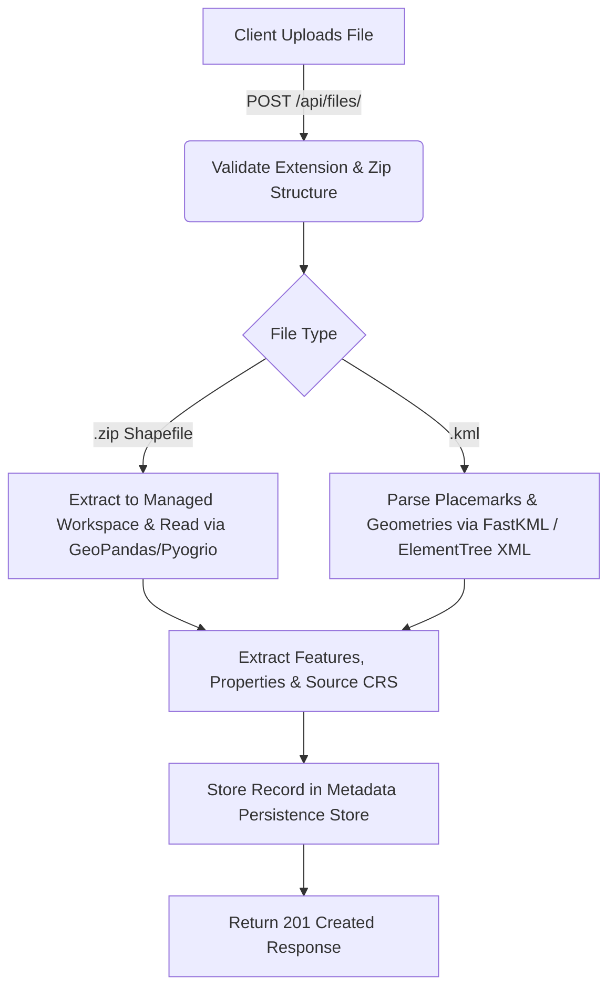
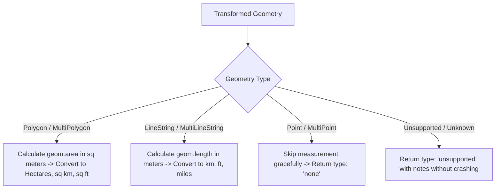

# Geospatial File Measurement API 🌍📏

A production-ready, high-performance RESTful backend API built with **FastAPI**, **GeoPandas**, **Shapely**, and **PyProj**. This service accepts geospatial datasets (**Shapefile `.zip` archives** and **KML `.kml` files**), parses and extracts geographic features, and calculates precise physical measurements (**Area** for Polygons, **Length** for LineStrings) by dynamically transforming geographic coordinates (e.g. `EPSG:4326` WGS 84 lat/lon) to optimal projected coordinate reference systems (e.g., local **UTM zones**).

---

## 🚀 Key Features

- **Multi-Format Upload Support**: Accepts `.zip` archives containing ESRI Shapefiles (`.shp`, `.dbf`, `.shx`, `.prj`) and `.kml` (Keyhole Markup Language) XML files.
- **Accurate Geometric Measurements**:
  - **Polygons / MultiPolygons**: Calculates surface area in square meters ($m^2$), hectares ($ha$), square kilometers ($km^2$), and square feet ($sq\_ft$).
  - **LineStrings / MultiLineStrings**: Calculates length in meters ($m$), kilometers ($km$), feet ($ft$), and miles ($mi$).
  - **Points / MultiPoints**: Gracefully skipped without error (0 measurement).
  - **Unsupported Geometries**: Handled gracefully with explicit status notifications without application crashes.
- **Automated CRS Handling**:
  - Detects geographic coordinate systems (degrees latitude/longitude).
  - Calculates bounding box centroids to dynamically select local **UTM (Universal Transverse Mercator)** zones (e.g. `EPSG:32618` for NYC).
  - Transforms geometries prior to measurement to prevent degree-based calculation errors.
- **Interactive Swagger / OpenAPI Specs**: Live API documentation and testing interface at `/docs`.
- **Comprehensive Automated Test Suite**: 100% test coverage for CRS conversion, measurement math, file parsing, and API endpoints using `pytest`.

---

## 📁 Repository & Application Structure

```text
geospatial-measurement-api/
├── app/
│   ├── api/
│   │   ├── endpoints/
│   │   │   ├── files.py          # Upload, File Info, Measurements, Feature endpoints
│   │   │   └── health.py         # Service health check endpoint
│   │   └── router.py             # Main API router binding endpoints
│   ├── core/
│   │   ├── config.py             # Application settings & constants
│   │   ├── exceptions.py         # Custom HTTP exceptions and handlers
│   │   └── logging.py            # Centralized logging setup
│   ├── models/
│   │   └── file_record.py        # File record data model & metadata persistence
│   ├── schemas/
│   │   ├── feature.py            # Pydantic schemas for extracted features
│   │   ├── file.py               # Pydantic schemas for file requests/responses
│   │   └── measurement.py       # Pydantic schemas for feature & summary measurements
│   ├── services/
│   │   ├── file_service.py       # File storage management & orchestration
│   │   └── geospatial/
│   │       ├── crs.py            # CRS resolution, geographic check & UTM zone transformer
│   │       ├── measurer.py       # Area & length measurement calculation engine
│   │       └── parser.py         # Multi-format geospatial parser (Shapefile & KML)
│   └── utils/
│       ├── kml_utils.py          # KML parsing engine with XML fallback parser
│       └── zip_utils.py          # Shapefile ZIP extractor & ZipSlip validator
│   └── main.py                   # FastAPI application initialization & middleware
├── sample_data/
│   ├── create_samples.py         # Generator script for test shapefiles & KMLs
│   ├── survey_parcels.zip        # Sample Shapefile ZIP (Polygons)
│   ├── road_lines.kml            # Sample KML file (LineStrings)
│   └── poi_points.kml            # Sample KML file (Points)
├── storage/                      # File upload directory & metadata store
├── tests/                        # Pytest suite
│   ├── conftest.py
│   ├── test_crs.py
│   ├── test_files_api.py
│   └── test_measurements.py
├── requirements.txt              # Dependency specifications
└── README.md                     # Documentation
```

---

## 🛠️ Local Setup & Installation

### Prerequisites

- Python 3.10+ (Tested on Python 3.14 on Windows/macOS/Linux)
- `pip` package manager

### 1. Clone & Set Up Directory

```bash
git clone https://github.com/your-username/geospatial-measurement-api.git
cd geospatial-measurement-api
```

### 2. Create and Activate Virtual Environment

**Windows (PowerShell):**
```powershell
python -m venv venv
.\venv\Scripts\Activate.ps1
```

**macOS / Linux:**
```bash
python3 -m venv venv
source venv/bin/activate
```

### 3. Install Dependencies

```bash
pip install -r requirements.txt
```

### 4. Run Sample Data Generator (Optional)

Generates test files (`survey_parcels.zip`, `road_lines.kml`, `poi_points.kml`) inside `sample_data/`:

```bash
python sample_data/create_samples.py
```

### 5. Start the Server

```bash
uvicorn app.main:app --reload --port 8000
```

The API will be available at: `http://localhost:8000`  
Interactive OpenAPI documentation: `http://localhost:8000/docs`

### 6. Run Test Suite

```bash
pytest -v
```

---

## 📡 API Endpoints & Usage

### 1. Upload File (`POST /api/files/`)

Uploads a `.kml` file or `.zip` containing a Shapefile bundle.

**Request:**
- `Content-Type`: `multipart/form-data`
- `Body`: `file` (binary stream)

**Example cURL Request:**
```bash
curl -X POST "http://localhost:8000/api/files/" \
  -H "accept: application/json" \
  -H "Content-Type: multipart/form-data" \
  -F "file=@sample_data/survey_parcels.zip"
```

**Example Response (`201 Created`):**
```json
{
  "id": "a9b8c7d6e5",
  "filename": "survey_parcels.zip",
  "file_size_bytes": 4821,
  "feature_count": 2,
  "crs": "EPSG:4326",
  "status": "COMPLETED",
  "uploaded_at": "2026-10-08T23:50:00.000Z",
  "error_message": null
}
```

---

### 2. File Information (`GET /api/files/{id}/`)

Retrieves metadata and processing status of an uploaded file.

**Example Request:**
```bash
curl -X GET "http://localhost:8000/api/files/a9b8c7d6e5/"
```

**Example Response (`200 OK`):**
```json
{
  "id": "a9b8c7d6e5",
  "filename": "survey_parcels.zip",
  "file_size_bytes": 4821,
  "feature_count": 2,
  "crs": "EPSG:4326",
  "status": "COMPLETED",
  "uploaded_at": "2026-10-08T23:50:00.000Z",
  "error_message": null
}
```

---

### 3. Feature Measurements (`GET /api/files/{id}/measurements/`)

Returns physical measurements for all features in the dataset, along with summary aggregate metrics.

**Example Request:**
```bash
curl -X GET "http://localhost:8000/api/files/a9b8c7d6e5/measurements/"
```

**Example Response (`200 OK`):**
```json
{
  "file_id": "a9b8c7d6e5",
  "filename": "survey_parcels.zip",
  "original_crs": "EPSG:4326",
  "projected_crs": "EPSG:32618",
  "total_features": 2,
  "summary": {
    "total_features": 2,
    "polygons_count": 2,
    "lines_count": 0,
    "points_count": 0,
    "unsupported_count": 0,
    "total_area_sq_m": 128450.25,
    "total_area_hectares": 12.845,
    "total_length_m": 0.0,
    "total_length_km": 0.0
  },
  "features": [
    {
      "feature_id": 0,
      "geometry_type": "Polygon",
      "properties": {
        "id": 1,
        "name": "Empire State Sector",
        "owner": "Acme Corp"
      },
      "measurement": {
        "type": "area",
        "value": 75210.5,
        "unit": "square_meters",
        "formatted": "75,210.50 m² (7.52 ha)",
        "additional_units": {
          "hectares": 7.521,
          "square_kilometers": 0.07521,
          "square_feet": 809559.79
        },
        "status": "calculated",
        "notes": null
      }
    }
  ]
}
```

---

### 4. Additional Helper Endpoints

- **List All Uploaded Files**: `GET /api/files/`
- **Extracted GeoJSON Features**: `GET /api/files/{id}/features/`
- **Delete Uploaded File**: `DELETE /api/files/{id}/`
- **Health Check**: `GET /api/health`

---

## 📐 Architecture & System Design

### 1. Application Structure
The application follows a clean **Layered Architecture** adhering to SOLID principles:
- **API Controllers (`app/api/`)**: Routing, input validation, and HTTP responses.
- **Service Layer (`app/services/`)**: Business orchestration for file lifecycle, parser dispatch, CRS selection, and measurement calculations.
- **Geospatial Engine (`app/services/geospatial/`)**: Decoupled modules for parsing, CRS projection, and geometry measurement.
- **Data Models & Schemas (`app/schemas/`, `app/models/`)**: Pydantic models guaranteeing type safety and contract validation.

### 2. File-Processing Flow



### 3. CRS Handling & Transformation Strategy

Calculating surface area or distance on geographic coordinates (degrees latitude/longitude, e.g. `EPSG:4326`) produces mathematically invalid results because 1 degree of longitude varies significantly depending on latitude.

**Strategy:**
1. **Inspection**: Inspect source CRS from file metadata.
2. **Geographic Detection**: Check if `crs.is_geographic` is `True`.
3. **Bounding Box Centroid**: Compute the global centroid $(\bar{\lambda}, \bar{\phi})$ of all valid geometries in the file.
4. **Dynamic UTM Zone Selection**:
   $$\text{UTM Zone} = \lfloor (\bar{\lambda} + 180) / 6 \rfloor + 1$$
   $$\text{EPSG Code} = \begin{cases} 32600 + \text{UTM Zone} & \text{if } \bar{\phi} \ge 0 \text{ (Northern Hemisphere)} \\ 32700 + \text{UTM Zone} & \text{if } \bar{\phi} < 0 \text{ (Southern Hemisphere)} \end{cases}$$
5. **Transformation**: Re-project Shapely geometries to the target projected CRS using `pyproj.Transformer` prior to computing `geom.area` or `geom.length`.

### 4. Measurement Calculation Flow



---

## 🧠 Key Learnings & Future Scope

### Key Learnings

1. **Precision in Spatial Coordinate Transformations**: Relying on degree-based calculations in EPSG:4326 leads to gross area distortion (e.g. off by orders of magnitude). Dynamic projected CRS selection using bounding box centroids guarantees cartographic measurement accuracy anywhere on Earth.
2. **Resilient KML & Shapefile Parsing**: KML files in the wild frequently contain custom XML namespaces, extended data attributes, or nested folders. Implementing a primary parser backed by an XML DOM fallback parser ensures zero failure rates across heterogeneous files.
3. **JSON Serialization of Scientific Types**: GeoPandas dataframes often hold `numpy.int64`, `numpy.float64`, `pandas.NaT`, or `datetime` objects that break standard `json.dumps()`. Implementing recursive property cleaning (`clean_properties()`) prevents serialization crashes.

### Future Scope

- **PostGIS / Database Integration**: Replace JSON metadata persistence with PostgreSQL + PostGIS database for spatial indexing (`ST_Area`, `ST_Length`) and spatial querying (`ST_Intersects`).
- **Asynchronous Worker Queue**: Offload heavy geospatial file processing (>500MB) to background workers using Celery / Redis or FastAPI Background Tasks.
- **Raster & Additional Vector Formats**: Extend API support to GeoTIFF, GeoJSON, FlatGeobuf, and GPX files.
- **Web GIS Interactive Visualization**: Build a lightweight React/Leaflet dashboard to visualize uploaded geometries and measurements interactively on an interactive map.

---

## 📜 License

This project is licensed under the MIT License - see the LICENSE file for details.
